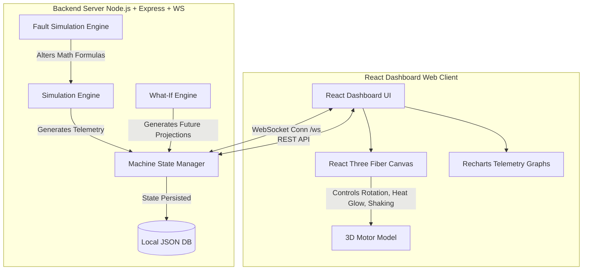

# TwinForge: Industrial Digital Twin & Predictive Simulation Platform

> **"We don't just monitor machines. We simulate their future."**

TwinForge is an immersive Industry 4.0 software prototype developed for hackathon presentation and demonstration. It features a virtual physical electric motor (`MTR-001`) modeled using mathematical relationships, a synchronized 3D digital twin rendering real-time responses, a deterministic fault cascade engine, and predictive intelligence capability.

---

## ⚠️ Critical Note

**TwinForge is a 100% software simulation.**
There are no physical sensors, ESP32/Arduino microcontrollers, external MQTT brokers, cloud services, or external AI API dependencies. The physical machine's behavior and the corresponding telemetry are modeled completely locally inside the system simulator to ensure absolute reliability and speed during presentation.

---

## 🌟 Key Features

### 1. 3D Digital Twin Visualizer
- Built using **React Three Fiber (R3F) & Three.js**.
- Interactive, rotatable 3D model of an induction motor showing body, rotor, shaft, bearings, cooling fan, and housing.
- Real-time physical feedback: visual shaft speed adjustments, dynamic vibration shaking, and thermal hotspot indicator glows based on real-time temperature telemetry.

### 2. Real-Time Telemetry & Correlated Simulator
- Simulates real-time values for Temperature, Vibration, RPM, Voltage, Current, Load, Bearing Health, Cooling Efficiency, and Overall Health.
- Variables are **mathematically correlated**:
  - Increasing load increases current, temperature, and slightly vibration, while decreasing overall efficiency.
  - Decreasing cooling efficiency raises temperature, accelerates bearing degradation, increases vibration, and raises failure risk.

### 3. Fault Lab (Injection System)
- Direct interactive controls for injecting specific industrial faults:
  - **Thermal**: Overheating, Cooling Failure.
  - **Mechanical**: Bearing Degradation, Shaft Imbalance, Excessive Vibration.
  - **Electrical**: Voltage Drop, Overcurrent, Power Instability.
  - **Load**: Excessive Load.
- Faults directly alter simulation equations, triggering smooth transitions instead of sudden state jumps.

### 4. Cascading Failure Engine
- Visualizes real-time propagation of faults. See how a simple **Cooling Failure** triggers **Thermal Stress**, leading to **Bearing Degradation**, which increases **Vibration** and ultimately causes a **Critical failure risk**.

### 5. What-If Simulator
- Run scenarios in a sandbox sandbox environment without affecting the active state of the live motor.
- Configure hypothetical constraints (e.g. *What if cooling efficiency drops by 40%?* or *What if voltage drops to 180V?*) and project the machine status over a 5, 10, 20, or 30-minute timeline.

### 6. Predictive Intelligence Engine
- Evaluates active parameters, rate of change, and historical trends to determine the current risk state (**Low / Medium / High / Critical**).
- Computes an estimated failure window (in simulated minutes), a confidence percentage, and recommended actions.
- Automatically generates a dynamic text explanation detailing **Why the risk is increasing** (no hardcoded responses).

### 7. Maintenance & Alert Centers
- Real-time logging of events and anomalies.
- Recommended maintenance actions categorized by priority and status.

---

## 📐 System Architecture

The project is structured with a clear segregation of concerns between the telemetry generation, the state synchronization, and the analysis dashboard:



---

## 🛠️ Technology Stack

- **Frontend**: React, TypeScript, Vite, Tailwind CSS
- **3D Graphics**: Three.js, React Three Fiber, Drei
- **Data Visualizations**: Recharts
- **Icons**: Lucide React
- **Backend**: Node.js, Express, WebSocket (`ws`)
- **State Persistence**: Local JSON Database (`data/twinforge_db.json`)
- **Process Orchestration**: Concurrently

---

## 🚀 Getting Started

### Prerequisites
Make sure you have [Node.js](https://nodejs.org/) installed (v18+ recommended).

### Installation
1. Clone the repository:
   ```bash
   git clone https://github.com/Roger-Chris/Twin_Forge.git
   cd Twin_Forge
   ```
2. Install dependencies for both client and server:
   ```bash
   npm install
   ```

### Running the Demo
Start both the Express backend server and Vite frontend dev client simultaneously with a single command:
```bash
npm run demo
```
- **Vite App Dev URL**: [http://localhost:5173](http://localhost:5173) (or the port specified in your console)
- **Express Port**: `3001` (WebSocket path: `ws://localhost:3001/ws`)

---

## 🎮 Perfect Demo Flow Guide

Use this sequence to deliver an impactful hackathon demonstration:

1. **Step 1: Startup State**
   - Click **Start Machine**. Note the smooth rotation of the 3D motor, the low vibration, a high health score (~96%), and a 3% failure risk.
2. **Step 2: Increase Load**
   - Use the **Machine Control** slider to increase Load to **85%**.
   - Observe the live graphs: Current rises, Temperature gradually ticks up, Vibration increases slightly, and overall Health dips.
3. **Step 3: Inject Cooling Failure**
   - Open the **Fault Lab** tab.
   - Click **Inject** on **Cooling Failure**.
4. **Step 4: Observe Cascading Effects**
   - Watch the **Telemetry Dashboard** and the **Fault Cascade** diagram.
   - The cooling efficiency will continuously decay, causing Temperature to spike, Bearing Health to degrade, and Vibration to shake the 3D motor model intensely.
5. **Step 5: Run What-If Simulation**
   - Navigate to the **What-If Lab**.
   - Click the preset scenario: *"What if cooling remains unavailable for 30 minutes?"*
   - Click **Run What-If Simulation**.
   - Review the **Failure Projection** timeline showing the step-by-step collapse and the *Twin Intelligence* diagnosis predicting a thermal/bearing failure window.
6. **Step 6: Maintenance Recommendation**
   - Review the **Maintenance Center** instructions recommending the immediate inspection of the cooling line and bearings.
7. **Step 7: Reset & Recover**
   - Click **Normalize** or **Reset** to return the simulation to stable, healthy conditions.